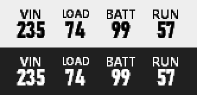
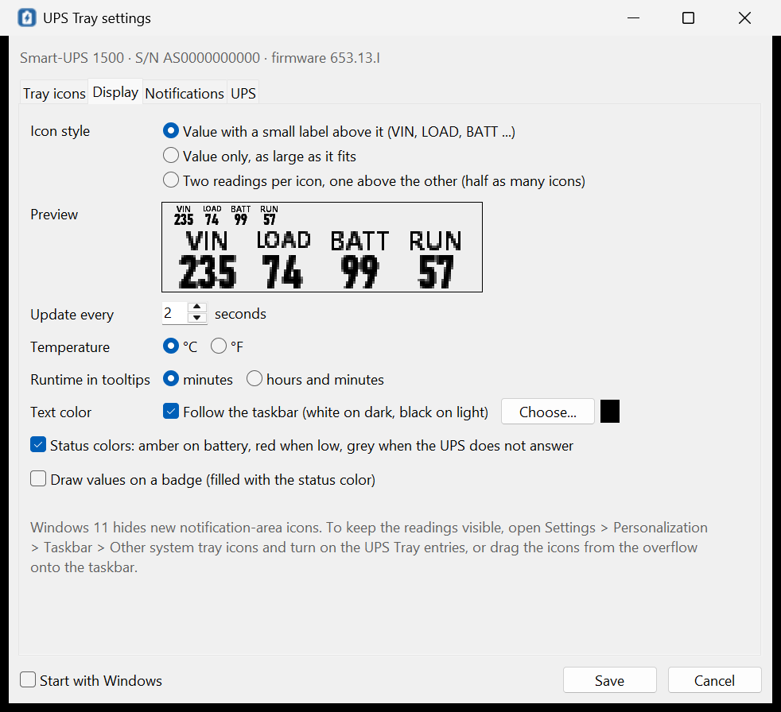
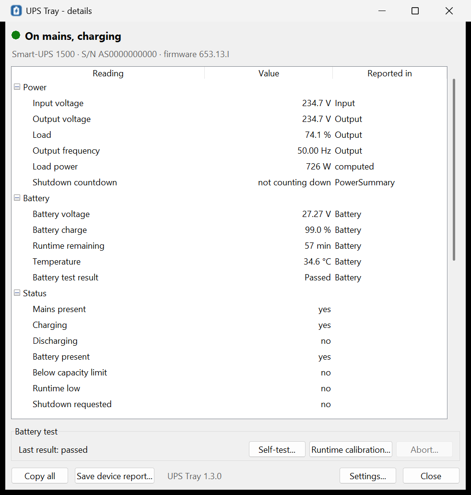
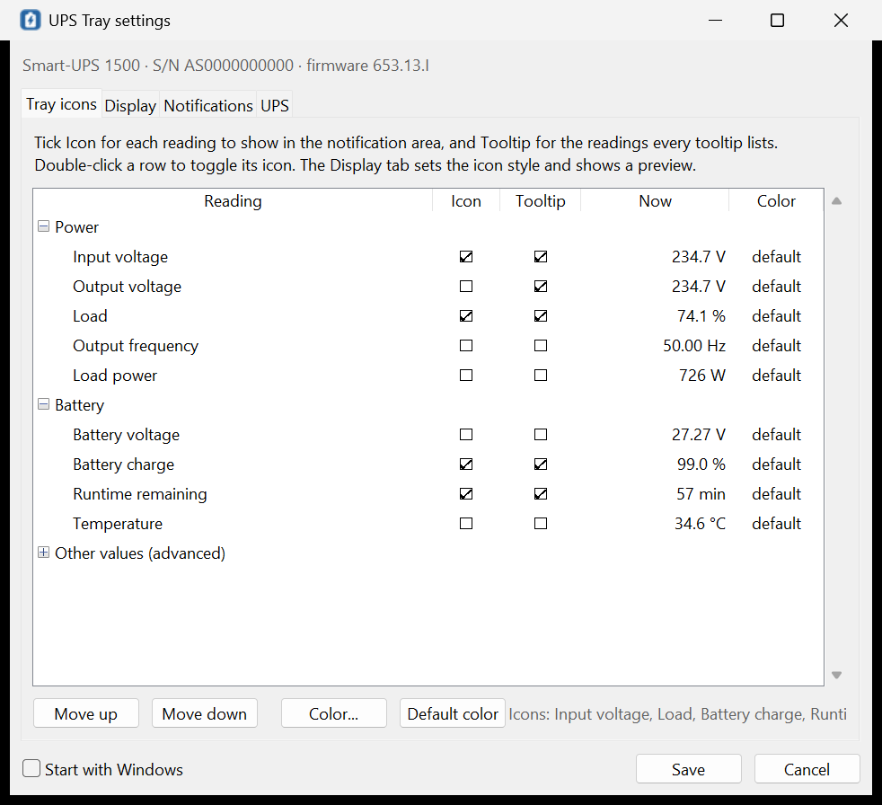

# UPS Tray

Live readings of a USB-connected **APC UPS** in the Windows notification area:
input and output voltage, load, battery charge, runtime, battery voltage,
temperature, frequency, and anything else the UPS reports. Every reading you
pick gets **its own tray icon** that shows the value as a number, so you can
see the mains voltage and the load at a glance without opening anything.

Works on Windows 10 and 11. Needs no driver, no service and no administrator
rights. It only ever **reads** the UPS.



## Install

1. Download `UpsTray-Setup-<version>.exe` from the
   [Releases page](https://github.com/n3rd-bugs/UpsTray/releases) and check
   it against `SHA256SUMS.txt` there:
   `Get-FileHash .\UpsTray-Setup-1.0.0.exe -Algorithm SHA256`
2. Run it. It installs for your account into
   `%LOCALAPPDATA%\Programs\UpsTray` without a UAC prompt (choose "all
   users" in the first dialog to install into Program Files instead) and can
   start UPS Tray when you sign in.
3. On the first start the Settings window opens: tick the readings you want
   as tray icons and press **Save**.

Windows 11 puts new tray icons in the overflow (the `^` arrow). To keep the
readings on the taskbar, open **Settings > Personalization > Taskbar >
Other system tray icons** and turn on the UPS Tray entries, or drag the icons
from the overflow onto the taskbar. Windows remembers this per reading.

The releases are not code-signed, so SmartScreen may warn the first time.

## Using it

- **Each icon** shows one reading with a small label above it: `VIN 231`,
  `LOAD 75`, `BATT 99`, `RUN 57` (minutes), `TEMP 35°` and so on. The tooltip
  names the reading, the power status and the other readings you chose for
  tooltips.
- **Icon styles** (Settings > Display, with a live preview): value with a
  label (default), value only (largest digits), or two readings stacked in
  one icon (half as many icons). Labels and stacking need icons of 20 px or
  more, that is display scaling of 125 % or higher; at 100 % the value is
  shown alone.

  
- **Colors** follow the power state: normal text on mains (white on a dark
  taskbar, black on a light one), **amber on battery**, **red when the
  battery is low**, grey with `--` when the UPS does not answer. You can
  turn this off, pick a fixed color per reading, or draw the values on a
  colored badge.
- **Click an icon** for the Details window: every value and status bit the UPS
  reports, updated live, with **Copy all** and **Save device report**.

  
- **Right-click an icon** for the menu: Details, Settings, Start with Windows,
  Open log folder, Exit.
- **Starting UPS Tray again** (Start menu) shows the details of the running
  copy; `UpsTray.exe --settings` opens its Settings.
- **Notifications** (optional): when the UPS has been on battery for a while,
  when mains returns, when the battery runs low, when the UPS stops
  answering. The on-battery notice waits (10 s by default) so short
  switch-overs, for example from a generator or an inverter, stay quiet.

### Settings



Tick **Icon** for the readings that get their own tray icon (up to 8, in the
order shown at the bottom; use Move up/down) and **Tooltip** for the readings
every tooltip lists. The other tabs set the update interval, units, colors
and notifications; the UPS tab shows the model, serial number, firmware and
battery date, and takes the rated power for the *Load power* reading.

### Readings

| Reading | From the UPS | Tray text |
|---|---|---|
| Input voltage, Output voltage | `Input/Output.Voltage` | `231` |
| Load | `Output.PercentLoad` | `75%` |
| Load power (W) | `Output.ActivePower`, or Load x the rated power you enter in Settings > UPS | `707` |
| Battery charge | `RemainingCapacity` (the finest one the UPS has) | `99%` |
| Runtime remaining | `RunTimeToEmpty` | `57` (minutes) |
| Battery voltage | `Battery.Voltage` | `27.3` |
| Temperature | `Battery.Temperature` | `35°` |
| Input/Output frequency, Output current, Apparent power | when the UPS reports them | `50.0` |
| Other values (advanced) | every other numeric value in the UPS's HID report descriptor, named by where it is reported | |

The Details window also lists the UPS settings it reports (transfer
voltages, nominal voltages, low-battery limits, alarm), the battery and UPS
dates, the last self-test result and the status bits (mains present,
charging, discharging, overload, replace battery ...).

Values are decoded with the HID unit rules (the UPS says what each number
means), so the readings need no per-model table. UPS Tray was developed on an
APC Smart-UPS 1500 (SUA1500I, firmware 653.13.I). Other APC Smart-UPS and
Back-UPS models, and other brands that connect by USB as a HID power device
(the ones Windows shows as a battery), should work; the Details window and a
saved device report show what a particular model offers.

## Works alongside

- **Windows' own UPS support** (the "HID UPS Battery" driver) and
  **PowerChute Serial Shutdown** both keep working: UPS Tray opens the UPS
  for reading only and never takes it over.
- With Windows' battery driver attached, Windows rewrites the UPS's
  low-capacity limit to just below the current charge, so that the UPS
  reports every change. UPS Tray therefore does not treat that limit as
  "battery low"; it uses your own threshold (20 % by default) and the UPS's
  low-runtime and shutdown-imminent bits.
- UPS Tray **never shuts the computer down**. Leave that to Windows' battery
  settings or to PowerChute.

## Command line

```
UpsTray.exe                start (or show the details of the running copy)
UpsTray.exe --settings     open Settings (in the running copy, or at start)
UpsTray.exe --quit         ask the running copy to exit
UpsTray.exe --version      print the version
UpsTray.exe --selftest     read-only checks; pass without a UPS
UpsTray.exe --dump         JSON report of the connected UPS (descriptor and values)
--out <file>               write the output to a file (the exe has no console)
```

## Files

| Where | What |
|---|---|
| `%LOCALAPPDATA%\Programs\UpsTray\app\` | the app (`UpsTray.exe` and its runtime); Program Files for an all-users install |
| `%LOCALAPPDATA%\UpsTray\settings.json` | your settings |
| `%LOCALAPPDATA%\UpsTray\upstray.log` | log (512 KB, 2 old copies kept) |
| `HKCU\Software\Microsoft\Windows\CurrentVersion\Run\UpsTray` | the sign-in entry, when chosen |

## Uninstall

Settings > Apps > Installed apps > UPS Tray > Uninstall. It stops a running
copy and removes the sign-in entry. Your settings and log in
`%LOCALAPPDATA%\UpsTray` stay; delete that folder if you do not need them.

## How it works

- `winhid.py` finds HID collections with usage page Power Device (0x84) and
  reads them through `hid.dll`: feature reports only, with
  `HidD_GetFeature`. The write calls (`HidD_SetFeature`, output reports,
  `WriteFile`) are not even bound, and a unit test fails if any of them
  appears in the code, so the app cannot change a UPS setting, start a test
  or switch the output off.
- `model.py` names the descriptor's usages (HID Power Device and Battery
  System pages), applies the units (a volt is 10^7 cgs units, so an APC
  battery voltage of 2727 with exponent 5 is 27.27 V), picks the well-known
  readings and derives the power status.
- `device.py` reads only the reports the visible icons and tooltips need,
  every 2 seconds by default, and reconnects when the UPS comes back.
- `glyphs.py` draws each value with GDI into a 32-bit icon with real alpha,
  choosing the font size (Bahnschrift Condensed first) that fits the icon size
  of your display scaling.
- `tray.py` owns the hidden window and the icons on its own thread; `ui.py`
  has the Tk windows; `app.py` ties them together.

## Build from source

Requirements: Windows 10/11 x64, 64-bit CPython 3.11, Inno Setup 6.7 or later
for the installer.

```powershell
git clone https://github.com/n3rd-bugs/UpsTray.git
cd UpsTray
powershell -NoProfile -ExecutionPolicy Bypass -File .\build.ps1
```

`build.ps1` creates `.venv-build` with the pinned, hash-checked tools from
`requirements-build.txt`, runs the unit tests, draws the icons, builds the
PyInstaller app, checks the frozen exe, compiles the installer and writes
`dist\SHA256SUMS.txt`. Releases are built by GitHub Actions
(`.github/workflows/build.yml`) when a `vX.Y.Z` tag is pushed.

To run from source without building:

```powershell
pythonw src\upstray_main.pyw
python tests\test_logic.py
```

## License

MIT, see [LICENSE](LICENSE). The installer also ships the licenses of the
bundled Python runtime, Tcl/Tk and the PyInstaller bootloader
(`THIRD-PARTY-NOTICES.txt`).
